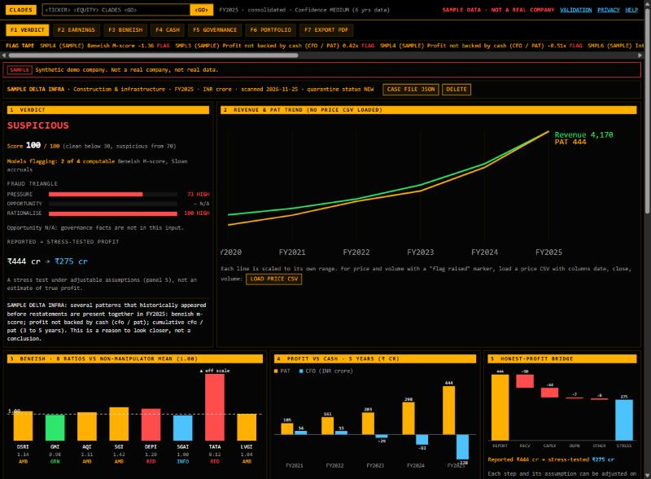
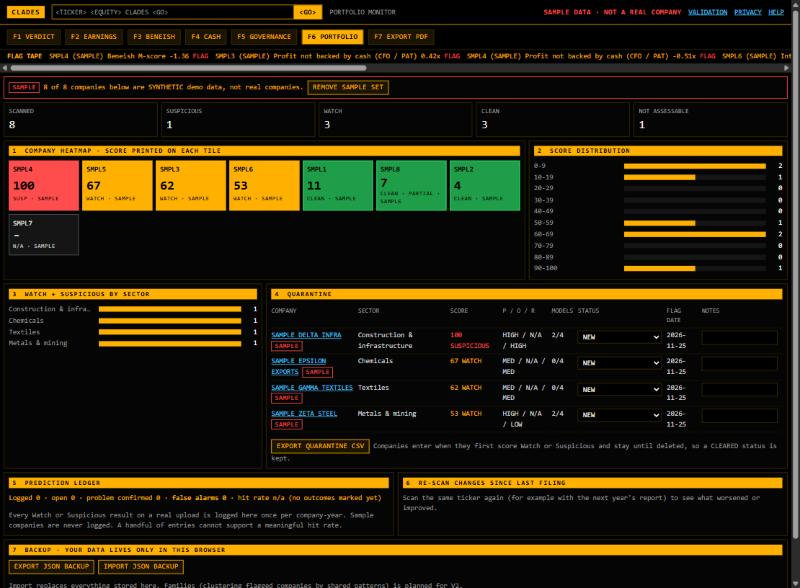

# CLADES

**Do these accounts look *too* good?** CLADES is a Bloomberg-terminal-style web app that reads a company's
financial report in your browser, runs a fixed library of published forensic-accounting checks, and shows which
patterns are worth a closer look, with the evidence and the innocent explanation for each.

Live: https://gogulavasan.github.io/clades/

> A flag means look closer, not fraud. Not investment advice.

## Status

| Build | Scope | State |
| --- | --- | --- |
| 1 | Terminal shell, CI, GitHub Pages deploy | Done |
| 2 | Schema, Excel/CSV ingest, confirm screen, integrity gate | Done |
| 3 | Beneish M-score with hand-calculated tests | Done |
| 4 | Other rule batteries, Fraud Triangle scoring, case file | Done |
| 5 | Company dashboard and portfolio monitor | Done |
| 6 | Manual entry and PDF extraction | Done |
| 7 | Honest-profit estimator, text/governance rules, price chart | Done |
| 8 | Offline benchmark builder and back-test tooling | Done (awaiting real data) |

Still open, and labelled as such in the app: the back-test has **not been run** (no hand-entered case data yet), sector
benchmarks are placeholders, the PDF route has been tested on a synthetic report and one real annual report, and the Families panel,
auditor tenure/size and receivables-ageing checks are not built.





## How it works

```
Excel/CSV | PDF | manual -> extract -> map columns -> CONFIRM (you review every figure) -> integrity gate
       -> standardised schema (INR crore) -> models + rule library -> Fraud Triangle score -> case file -> screens
```

- **Static site only.** Vite + strict TypeScript on GitHub Pages. No server, database, API key or LLM call.
- **Private by construction.** Files are analysed in the browser tab. A Content-Security-Policy in `index.html`
  blocks the page from contacting any other origin. Results are kept in `localStorage`; Export / Import JSON on the
  Portfolio screen is the backup.
- **Nothing is invented.** A missing figure stays missing and every check that needs it reports NO DATA.
- **One case file.** After scoring, a single object (scores, inputs, formulas, sources, confidence, data-quality
  notes) is built; every screen and export renders from it.

### Data formats

1. **Screener.in "Export to Excel"** (`Data Sheet`): read as it is, in INR crore.
2. **Any spreadsheet or CSV** with line items down the first column and years across the top. Labels are matched by
   the alias table in `config/mapping.json`; anything unmatched is left unmapped and can be mapped by hand on the
   confirm screen.
3. **PDF annual report** (pdf.js, in the browser). Rule-based: statement pages are found by their headings, a page
   must be a table to qualify, and each line's last two numbers are read as current and prior year. The balance-sheet
   section a line sits in decides, for example, whether "Borrowings" is long-term or short-term. Landscape pages
   are also read as two halves, because many reports are exported as two-page spreads; the P&L and cash flow are taken
   from the pages that follow the chosen balance sheet so all three come from the same (consolidated) set; a section
   subtotal printed as bare numbers is read by position and tagged LOW. The whole text is
   also scanned (column by column, so quotes are not stitched across columns) with the regex lexicon in `config/lexicon.json`; every match is shown as a quoted sentence with its
   page. Scanned PDFs have no text layer: the app says so and opens manual entry. No OCR is used.
4. **Manual entry.** Pick the latest year and how many years; the confirm screen becomes the form.
5. **Optional price CSV** per company (`date, close, volume`) for the price/volume panel.

Screener exports do not split current from non-current items and do not report long-term debt separately. Three
stand-ins are used and tagged **PROXY** everywhere (Other Assets for current assets, Other Liabilities for current
liabilities, total Borrowings for long-term debt). They lower the confidence level and can be switched off, in which
case AQI and LVGI are missing and no M-score is produced.

### Methodology

- **Beneish M-score** (Beneish 1999): all eight ratios, `M = -4.84 + 0.920 DSRI + 0.528 GMI + 0.404 AQI + 0.892 SGI
  + 0.115 DEPI - 0.172 SGAI + 4.679 TATA - 0.327 LVGI`. Two-key verdict: Clean needs M below -1.78 **and** at most
  two red ratios; strict mode needs every traffic-lighted ratio green. SGAI is shown as information only because its
  reference means barely differ and its weight is negative.
- **Other models:** Sloan accruals, Altman Z'' (emerging markets), Piotroski F. The Dechow F-score is deliberately
  left out: its coefficients have not been verified against the source paper, and guessing them is not acceptable.
- **Rule library:** 28 rules across earnings quality, revenue quality, cost and asset games, balance-sheet logic,
  too-good-to-be-true, cross-statement consistency and an India pack. Each rule in `config/rules.json` carries its
  formula, thresholds, weight, plain-English meaning, innocent explanation and next step. The formula language
  (`src/rules/formula.ts`) means rules can be added, tuned or disabled without touching code.
- **Fraud Triangle:** every rule feeds Pressure, Opportunity or Rationalisation (0-100 each). Combination rules raise
  the score when several weak signals appear together. Tiers: Clean below 30, Watch 30-69, Suspicious 70+.
- **Honest-profit bridge:** reported profit less four adjustable stress adjustments (receivables build-up, growth
  in soft assets, depreciation back to last year's rate, other income), each shown after tax in a waterfall. The
  defaults are harsh round numbers; it answers "how much of this profit rests on soft items?", not "what is true profit?".
- **Governance and text (PDF only):** nine lexicon rules (modified audit opinion, going-concern doubt, emphasis of
  matter, auditor resignation, defaults, related-party loans, pledging, delays, key audit matters) feed the Opportunity
  leg. Negated boilerplate such as "has not defaulted" is skipped. "No match" means the phrase was not found, not
  that the matter is absent.
- **Confidence:** lowered for few years of data, proxies, low-confidence figures, integrity warnings, low rule
  coverage and placeholder benchmarks. A Suspicious score on low confidence is shown as **unconfirmed**.

## Offline research (Python, standard library only)

| File | Purpose |
| --- | --- |
| `scripts/build_benchmarks.py` | Sector medians from a CSV you supply into `config/benchmarks.json`, with date, source and coverage. |
| `notebooks/cases_template.csv` | The known Indian cases with empty figure columns. Copy to `cases.csv` and fill from original annual reports. |
| `scripts/backtest.py` | M-score per company-year, hit rate, false-positive rate on the control group, precision, ROC AUC, years flagged early, base-rate table. Threshold tuned on an earlier period, tested on a later one. Writes `config/validation.json`. |
| `notebooks/backtest.ipynb` | Walks through the back-test and ends with a leakage checklist. |
| `scripts/make_sample_pdf.py` | Rebuilds the synthetic sample PDF. |

The back-test never fills a blank and counts a case as positive only in the years strictly before its event, using
accounts as first filed. `python scripts/backtest.py --selftest` checks the Python formulas against the same
hand-calculated example as the TypeScript tests. Never commit raw vendor data: keep it in `data/raw/` (git-ignored).

## Run it

```bash
npm ci
npm run dev     # local dev server
npm test        # unit tests
npm run lint    # eslint + type check
npm run build   # production build into dist/
```

## Deploy

Pushing to `main` runs `.github/workflows/deploy.yml`: install, lint, test, build, deploy to Pages. A failing test
stops the deploy.

The site sub-path is one variable, `BASE_PATH` in `vite.config.ts` (default `/clades/`). To deploy under another
repo name or a custom domain, change it there or set `CLADES_BASE` at build time. In the repository settings, Pages
source must be "GitHub Actions".

## Keyboard

`F1`-`F5` company tabs, `F6` portfolio, `F7` export PDF (the browser's print dialog; `Alt+1`-`Alt+7` do the same),
`/` focuses the command line. Commands: `SMPL4 <EQUITY> CLADES <GO>`, `SMPL4 BENEISH`, `PORT`, `VAL`, `PRIV`, `HELP`.

## What could be wrong with this

- **A flag is not proof.** Every pattern here also has ordinary business explanations, shown beside each flag.
- **Weights and cut-offs are judgment.** The rule weights, amber/red thresholds, leg saturation and combination
  rules are the author's choices. They have not been back-tested, so the 30 and 70 tier lines carry no measured
  hit rate or false-alarm rate yet.
- **US-calibrated references.** Beneish (1999) was fitted on US companies from the 1980s and 1990s. Its reference
  means and thresholds are not recalibrated on Indian data.
- **Correlated signals.** The M-score, its eight ratios and the accruals rules overlap, so one underlying issue can
  score several times.
- **Proxies.** With Screener data, AQI, LVGI and Altman Z'' rest on stand-in figures.
- **Placeholder benchmarks.** Sector comparisons use round illustrative values, not measured medians.
- **The demo set is synthetic.** Sample companies were designed to span the tiers, so their scores say nothing
  about how the rules perform on real companies.
- **Benford's law does not suit this data.** A company's line items over several years are highly correlated; the
  test raised a false alarm on the synthetic clean company, so it is displayed but carries no weight.
- **Small sample of known cases.** There are few well-documented Indian restatement cases, so any hit rate will have
  a wide error band.
- **Survivorship and look-ahead bias.** Known blow-ups are chosen with hindsight, and data providers show restated
  figures, which can leak the answer into a back-test.
- **Ind AS transition.** Accounts before and after the move to Ind AS (FY2017-FY2018) are not directly comparable.
- **Extraction errors.** Figures read from a spreadsheet or PDF can be wrong; the confirm step exists so a person
  checks them before anything is scored.
- **Text rules are keyword matches.** They miss paraphrases and can quote a sentence out of context. A rule that
  finds nothing has not established that nothing is there.
- **The honest-profit bridge is a stress test.** Its "soft assets" bucket also contains genuine investments and
  goodwill, and its default percentages are arbitrary.
- **Tested on one real annual report only.** A 395-page integrated report exposed five extraction failures (two-page
  spreads, multi-column prose, roman-numeral section headings, unlabelled subtotals, and a standalone statement set
  printed before the consolidated one). Each is fixed and covered by a regression test built from synthetic content,
  but one report is not a sample: other layouts will break it in new ways. No real Screener export has been tested.
- **Exceptional items are not adjusted.** A large one-off gain (for example on selling an investment) sits in profit
  while its cash sits in investing activities, so CFO/PAT looks weak for an innocent reason. Likewise, capex far above
  depreciation is normal for a company building infrastructure. Read the innocent explanation beside each flag.

## More

- `docs/INTERVIEW.md`: 30-second pitch, walkthrough and ten tough questions.
- Privacy page in the app: data lives only in your browser.

## Licence

MIT. See `LICENSE`.
